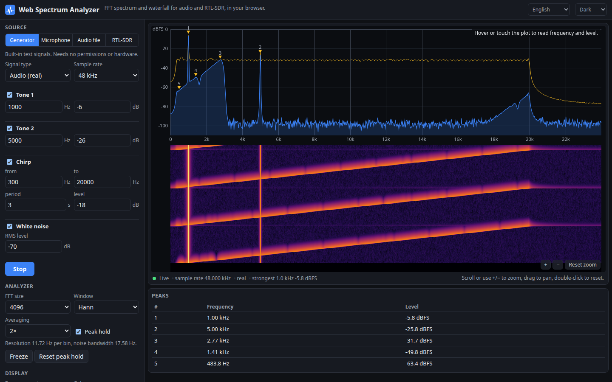

# Web Spectrum Analyzer

A real-time spectrum analyzer and scrolling waterfall that runs entirely in your browser. Point it at the microphone, an audio file, a built-in signal generator, or an RTL-SDR dongle over WebUSB. It uses its own FFT, so the window and size are yours to choose, and nothing is uploaded anywhere.

**Try it: [hermes98761234.github.io/web-spectrum-analyzer](https://hermes98761234.github.io/web-spectrum-analyzer/)**

[](https://github.com/hermes98761234/web-spectrum-analyzer/actions/workflows/deploy.yml)



## Features

- **Four sources.** The microphone (Web Audio, with echo cancellation, noise suppression and AGC switched off), a looped audio file, a signal generator (tones, chirp, white noise) that needs no permissions, and an RTL-SDR dongle over WebUSB.
- **Your own FFT.** Sizes 256 to 32768, and windows: Hann, Hamming, Blackman-Harris, flat-top and rectangular. Levels are in dBFS: a full-scale sine reads 0 dBFS in any window. The resolution and noise bandwidth are shown for the current setting.
- **Spectrum view.** Power-domain averaging (1 to 64 frames), peak hold, numbered peak markers with a peak table, a frequency and level cursor with nearest musical note, auto-levels, and wheel zoom, drag to pan and double-click to reset.
- **Scrolling waterfall** on the same frequency axis, with five colour maps (Viridis, Inferno, Turbo, classic SDR, grayscale) and an adjustable speed.
- **Log or linear frequency axis** for audio. IQ sources use a linear axis around the centre frequency.
- **RTL-SDR control.** Centre frequency, sample rate, tuner gain (auto or manual), ppm correction, DC-spike removal, band presets, click-to-tune. A mono WBFM / AM demodulator lets you listen to the channel you click.
- **Simulated SDR.** The generator can produce complex IQ at 2 MS/s, so you can try the whole SDR display with no hardware.
- **WebUSB-less browsers are handled.** Firefox and Safari have no WebUSB. The RTL-SDR tab then explains why and the other sources keep working.
- **English or Ukrainian, light, dark or system theme.** All settings are remembered in the browser. It is responsive for phones.

## How it works

The sources push samples into a ring buffer. About 30 times a second the analyzer takes the latest N samples, applies the window, runs an in-place radix-2 complex FFT and scales the result to dBFS. Real input is scaled so a full-scale sine reads 0 dBFS (single-sided). Complex input is scaled so a full-scale complex exponential reads 0 dBFS, and the output is shifted so the axis runs from `centre − fs/2` to `centre + fs/2`. Power is averaged in the linear domain, then converted to dB. Peaks come from local maxima, refined by parabolic interpolation.

The plot resamples bins to pixel columns. A column that spans many bins shows the maximum, so a narrow peak never disappears when you zoom out.

**The RTL-SDR driver** is a TypeScript port of the RTL2832U and R820T logic from [rtlsdrjs](https://github.com/sandeepmistry/rtlsdrjs) by Sandeep Mistry, which in turn comes from Google's [Radio Receiver](https://github.com/google/radioreceiver) Chrome app. Both are Apache-2.0. The port lives in `src/lib/rtlsdr/` with the original licence text next to it. It talks to the dongle with WebUSB control transfers, initialises the demodulator and tuner, sets the sample rate and frequency, and reads IQ with bulk transfers. Changes from upstream: typed classes, errors that are thrown instead of swallowed, a probe for both tuner I²C addresses (R820T at 0x34, R828D at 0x74), the R828D input switch, and a read loop that keeps one transfer in flight.

**Limitations.** The RTL-SDR path has been tested against a simulated dongle in the unit tests, not against every real device. R820T/R820T2/R828D tuners are supported. E4000, FC0012 and FC0013 dongles are not. The R828D support follows the librtlsdr register layout, but the RTL-SDR Blog V3 HF direct-sampling mode is not implemented.

**Getting a dongle to connect.**

- Use a Chromium-based browser on desktop or Android. WebUSB needs HTTPS or localhost.
- Linux: unload the kernel TV driver (`sudo rmmod dvb_usb_rtl28xxu rtl2832`) and add a udev rule for vendor `0bda`, product `2838`.
- Windows: install the WinUSB driver for the dongle with [Zadig](https://zadig.akeo.ie/).
- Close other SDR programs that hold the device.

## Quick start

You need [Node.js](https://nodejs.org/) 22.

```bash
git clone https://github.com/hermes98761234/web-spectrum-analyzer.git
cd web-spectrum-analyzer
npm install
npm run dev       # http://localhost:5173
npm test          # FFT, windows, spectrum, generator, demod, axis, RTL-SDR driver and i18n tests
npm run build     # static site in dist/
```

The DSP lives in `src/lib/` as pure functions with tests: Parseval's theorem, a known tone landing in the right bin at the right level for every window, window coherent gain and noise bandwidth against textbook values, power averaging, peak interpolation, and WBFM and AM demodulation of known tones.

## License

MIT. The RTL-SDR driver code in `src/lib/rtlsdr/` is derived from Apache-2.0 sources (see `src/lib/rtlsdr/LICENSE`).
